# Hi, I'm Emon 👋

  

Welcome to my GitHub profile! I'm a CSE graduate interested in building practical web applications, solving technical problems and exploring emerging technologies.

## 🚀 About Me

I'm currently working as a **Technical Support Engineer** at Zepto Apps, where I troubleshoot Shopify applications, investigate frontend issues and collaborate with development teams to resolve technical problems.

My background includes full-stack web development, with hands-on experience building responsive web applications using React, JavaScript, PHP and modern web technologies.

I'm particularly interested in frontend and full-stack development, while also exploring AI integration and Large Language Models (LLMs). I enjoy learning through practical projects, solving problems and turning ideas into working applications.

## 💻 Featured Projects

### 🌿 Plant Disease Classifier
A machine learning-powered web application that predicts plant diseases from uploaded leaf images.

**Tech Stack:** React, Tailwind CSS, Python, FastAPI, TensorFlow

[View Repository](https://github.com/emon5369/Plant_Disease_Classifier_web_app)

### 💊 PharmaTrack
A pharmacy management application for handling inventory, prescriptions, sales and expense tracking.

**Tech Stack:** React, Tailwind CSS, PHP, MySQL

[View Repository](https://github.com/emon5369/PharmaTrack)

### 💬 UsChat
A real-time chat application with authentication and messaging functionality.

**Tech Stack:** React, Tailwind CSS, Appwrite

[View Repository](https://github.com/emon5369/chat-app)

## 🛠️ Skills & Technologies

### Programming Languages

### Frontend Development

### Backend & APIs

### Databases

### Machine Learning

### Tools & Platforms

## 📖 Currently Learning

I'm currently expanding my skills at the intersection of **Web Development and AI**.

- **TypeScript:** Strengthening type safety and building maintainable applications.
- **AI Integration & LLMs:** Exploring how to integrate AI capabilities into web applications.
- **PostgreSQL:** Learning relational database design and querying.
- **Docker:** Improving my understanding of containerization and deployment.

## 📊 GitHub Statistics

  
  

## 🤝 Connect With Me

- **Portfolio:** [mdemonhossain.vercel.app](https://mdemonhossain.vercel.app/)
- **LinkedIn:** [linkedin.com/in/emon5369](https://www.linkedin.com/in/emon5369/)
- **Email:** [emon5369@gmail.com](mailto:emon5369@gmail.com)

---

  Thanks for visiting my profile! Feel free to explore my repositories and connect with me.

